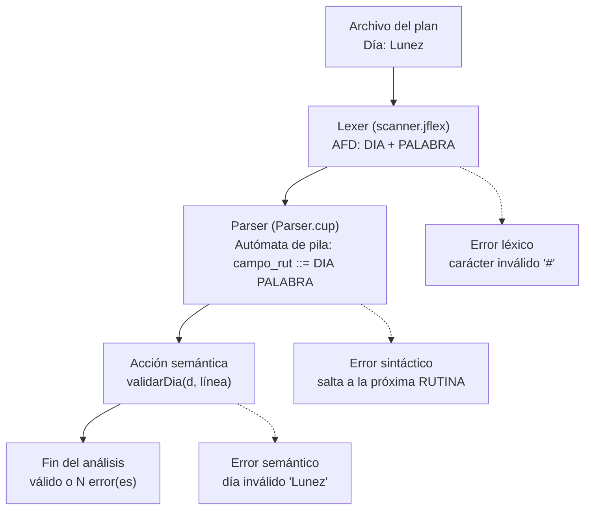

# Analizador de Planes de Entrenamiento

Obligatorio de Teoría de la Computación: analizador léxico (JFlex) y sintáctico (CUP) que lee un plan de entrenamiento, valida su estructura y reporta errores léxicos, sintácticos y semánticos indicando la línea.

## Estructura del proyecto

```
Obligatorio-Teoria/
├── lib/
│   ├── jflex-1.9.1.jar
│   ├── java-cup-11b-20160615-3.jar
│   └── java-cup-runtime-11b-20160615-3.jar
└── src/
    ├── scanner.jflex               ← analizador léxico (tokens)
    ├── Parser.cup                  ← gramática + validaciones + main
    ├── build.bat                   ← genera, compila y ejecuta
    ├── prueba_error_0_series.txt   ← referencia a una rutina ausente
    ├── prueba_ok.txt               ← ejemplo de la letra (válido)
    ├── prueba_errores_completa.txt ← cobertura de errores y recuperación
    └── prueba_errores.txt          ← casos con errores a propósito
```

`Lexer.java`, `parser.java`, `sym.java` y los `.class` **se generan solos** al compilar. No se editan a mano: siempre se modifican `scanner.jflex` y `Parser.cup`.

## Requisitos

- JDK 17 o superior (`java -version` y `javac -version` tienen que responder).
- Los tres jars en la carpeta `lib`.

## Cómo compilar y ejecutar

Desde la carpeta `src`:

```
cd src
.\build prueba_ok.txt
```

(En cmd alcanza con `build prueba_ok.txt`; en PowerShell hace falta el `.\`.)

`build.bat` hace cuatro pasos y se detiene si alguno falla:

1. JFlex genera `Lexer.java` a partir de `scanner.jflex`.
2. CUP genera `parser.java` y `sym.java` a partir de `Parser.cup`.
3. `javac` compila todo con codificación UTF-8 (por las tildes).
4. Se ejecuta `parser` con el archivo indicado.

Antes de subir cambios, verificar que CUP siga mostrando **`0 conflicts detected`**.

## Cómo funciona la validación

Cada etapa se ocupa de un tipo de problema distinto:



1. **Léxico (`scanner.jflex`)** – JFlex convierte las expresiones regulares en un AFD que corta el texto en tokens. Solo controla que cada palabra esté bien formada; no sabe si `Lunez` es un día. Lo que no matchea ningún patrón (`#`, comillas sin cerrar, `60kgs`) es un error léxico.
2. **Sintáctico (`Parser.cup`)** – CUP genera un parser LALR(1) (autómata de pila) a partir de la gramática y controla que los tokens vengan en un orden válido. Ante un error dentro de una rutina, la regla `rutina ::= RUTINA error` descarta tokens hasta la próxima `RUTINA` y el análisis continúa.
3. **Semántico (acciones de CUP)** – Al reconocer cada campo se llama a su función de validación con el valor y la línea, por ejemplo:
   ```
   | DIA:k PALABRA:d  {: validarDia(d, kleft); ... :}
   ```
4. **Rutina completa** – Al terminar una rutina, `validarRutina` revisa nombre repetido, campos duplicados y campos obligatorios faltantes.

Todos los errores pasan por `parser.reportar(...)`, que les da el formato:

```
[Línea N] Error <léxico|sintáctico|semántico>: <mensaje>
```

y los cuenta para el mensaje final.

### Por qué los valores se validan en la acción y no con un token por valor

Si `LUNES`, `MARTES`, … fueran tokens, `Lunez` produciría un error sintáctico genérico y cortaría la rutina. Aceptando cualquier `PALABRA` y validando en la acción semántica, el mensaje es claro (`día inválido 'Lunez'`), el análisis continúa y la gramática queda más chica.

## Validaciones implementadas

| Campo | Validación |
|---|---|
| Nivel | `PRINCIPIANTE`, `INTERMEDIO` o `AVANZADO` (sin distinguir mayúsculas) |
| Semanas | entero entre 1 y 52 |
| Fecha | día y mes de 1 o 2 dígitos, año positivo de 4 dígitos y fecha real, incluidos años bisiestos |
| Profesor, Calentamiento, Obs | texto no vacío |
| Objetivos, Músculos, Equipamiento, Variantes | lista no vacía y sin elementos repetidos |
| Día | lunes a domingo, con o sin tilde |
| Intensidad | `1/5`–`5/5`, `*`–`*****`, o `MUY BAJA` / `BAJA` / `MEDIA` / `ALTA` / `MUY ALTA` |
| Duración | `<número><h\|m\|s>`, mayor que 0 y como máximo 24 h |
| Extra | pares `etiqueta=valor` separados por coma, sin etiquetas repetidas |
| Encabezado | presentes Nivel, Objetivos, Semanas, Profesor y Fecha, sin repetir |
| Rutina | nombre no repetido en el plan, sin campos duplicados, campos obligatorios presentes |
| Plan | al menos una rutina |

## Decisiones de diseño

- **Orden libre de campos**: los campos del encabezado y de la rutina pueden venir en cualquier orden. Los duplicados y faltantes se controlan semánticamente.
- **Campos obligatorios de una rutina**: `Día`, `Intensidad`, `Duración` y `Músculos`. Con `Igual a`, se heredan los campos que la rutina no redeclara, incluido `Día`.
- **`Obs` es opcional**, ya que la rutina "Día C" del ejemplo de la letra no lo tiene.
- **Intensidad en texto**: para cubrir los 5 niveles que pide la letra se agregan `MUY BAJA` y `MUY ALTA`. Equivalencia: MUY BAJA = 1, BAJA = 2, MEDIA = 3, ALTA = 4, MUY ALTA = 5.
- **Repetición en porcentaje** acepta múltiplos positivos de 100. Cada 100% representa una vuelta completa.
- **`EXCEPTO`** permite quitar ejercicios individuales, incluso dentro de una superserie, y superseries completas con nombre.
- **Fecha y fracción**: el lexer acepta cualquier `n/n/n` y `n/n`; los rangos se validan en el parser para dar mensajes más claros.

## Organización del trabajo

| Persona | Parte |
|---|---|
| 1 | Validación del encabezado (`PLAN`, `Nivel`, `Objetivos`, `Semanas`, `Profesor`, `Fecha`) |
| 2 | Validación palabra por palabra: reconocimiento de cada token y validación de su valor en las acciones semánticas |
| 3 | El resto: tipos de ejercicio, unidades, superserie, `Igual a` (`x N vez/veces`, `N%`, `EXCEPTO`) y herencia de campos |

## Pruebas

```
.\build.bat prueba_ok.txt
.\build.bat prueba_errores.txt
.\build.bat prueba_error_0_series.txt
.\build.bat prueba_errores_completa.txt
```

| Archivo | Resultado esperado |
|---|---|
| `prueba_ok.txt` | Plan válido |
| `prueba_errores.txt` | 15 errores |
| `prueba_error_0_series.txt` | 1 error por referencia a una rutina ausente |
| `prueba_errores_completa.txt` | 88 errores (3 léxicos, 10 sintácticos y 75 semánticos) |

### Cómo verificar la prueba completa

| Líneas | Qué debe reportar |
|---|---|
| 1–9 | 12 errores de encabezado, incluidos valores inválidos y campos repetidos |
| 23–57 | 32 errores de campos, nombres y rutinas duplicadas o incompletas |
| 59–79 | 18 errores de series, repeticiones, tiempos, cargas, velocidad, superseries y nombres reservados |
| 81–112 | 12 errores de referencias, modificadores de repetición y exclusiones |
| 117–153 | 3 errores léxicos y 9 sintácticos. Si falta un token, CUP puede señalar el inicio de la rutina siguiente |
| 154–159 | Error semántico por `Domingoo` en la rutina de control, seguido de un error sintáctico por fin de archivo |

Para verificar los casos que requieren su propio archivo, probá estas entradas por separado.

- Un archivo con solo `PLAN "Sin campos ni rutinas"` debe informar 6 errores semánticos, uno por cada campo obligatorio del encabezado y uno por la ausencia de rutinas.
- Un archivo con solo `RUTINA "Sin encabezado"` debe informar un error sintáctico en la línea 1 y abortar el análisis.
- Una copia de `prueba_ok.txt` con la primera línea reducida a `PLAN` debe informar un error sintáctico en `Nivel:` y continuar con las rutinas.
